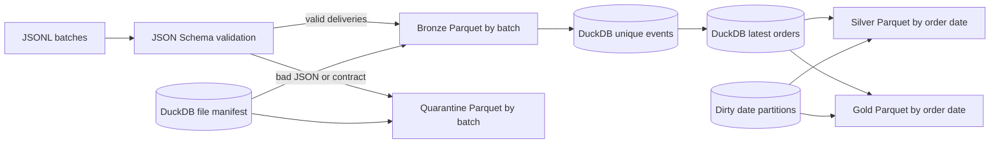

# Architecture and recovery

`meta.files` records each source filename and SHA-256 digest. Reprocessing an identical file is a no-op; changing an already processed filename is an error. Bronze preserves every contract-valid delivery, including identical duplicates. `core.events` keeps one row per `event_id` and `(order_id, event_version)`. A repeated ID with different content, or a changed stable order attribute, rejects the entire file transaction. Malformed JSON, unexpected/missing fields, and invalid values are retained in `core.quarantine` and exported as Parquet with a reason.

`core.orders` keeps the highest event version for each order. It does not use `updated_at` as an ingestion cursor, so a later file can carry earlier event time. Silver exports that latest order state. Gold groups current order statuses and paid revenue by order date and currency. Only order-date partitions affected by new latest states are rewritten; an integration test confirms an unrelated partition keeps its original file timestamp.

DuckDB state and the file manifest commit in one transaction. Parquet files are exported after commit. A pending `exported=false` flag and `meta.dirty_partitions` survive a crash between database commit and file export. The next run rebuilds pending files and partitions before ingesting new input. Each export writes a temporary Parquet file and atomically replaces its destination. The database and all Parquet files are then checked by `src/check_quality.py`.

This is a single-writer local lab. Partition files are replaced individually, so readers can observe a partially refreshed set while a run is active. A production multi-reader design would publish versioned snapshots through an atomic catalog pointer. The row-wise validation and SQL lookups also favor clarity over high-volume throughput.
